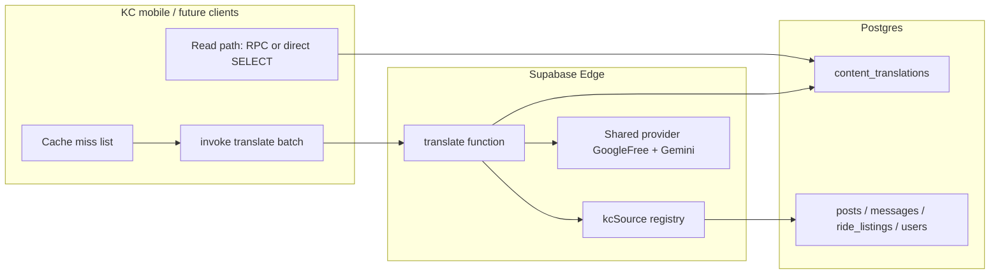

# UGC auto-translation (KC)

Demand-driven translation for Karma Community user-generated content. Translations are materialized lazily per `(content_type, content_id, field, target_language)`, cached in Postgres, and served on subsequent reads.

## Architecture



### Components

| Piece | Location | Role |
| --- | --- | --- |
| Cache table | `public.content_translations` | One row per translation key; service-role writes only |
| Source registry | `supabase/functions/_shared/translation/kcSource.ts` | Maps `contentType` → table, PK, allowed fields; server-side reads only (anti-poisoning) |
| Batch resolver | `supabase/functions/translate/resolveBatch.ts` | Cache hit / short-circuit / bounded provider fan-out (`translateMany`) |
| Single path | `supabase/functions/translate/single.ts` | Legacy one-field call with JWT + RLS visibility check |
| HTTP entry | `supabase/functions/translate/index.ts` | Routes single vs `{ targetLanguage, items[] }` batch |
| Shared provider | `supabase/functions/_shared/translation/*` | Language allow-list, short-circuit heuristics, provider seam |
| App adapter | `EdgeFnTranslationService` | `requestTranslation` (single) + `requestTranslationsBatch` |
| Feed materialization | `MaterializePostTranslationsUseCase` | Sends all post misses in one batch invoke |

Migration `0238` drops GloWe-only `glowe_content_translations`; KC uses **`content_translations` only**. Migration `0239` extends CHECK constraints and purge triggers for `ride_listing` and `user` biography.

### Batch API contract

```http
POST /functions/v1/translate
Authorization: Bearer <user JWT>
Content-Type: application/json

{
  "targetLanguage": "en",
  "items": [
    { "contentType": "post", "contentId": "<uuid>", "field": "title" },
    { "contentType": "ride_listing", "contentId": "<uuid>", "field": "description" }
  ]
}
```

Response:

```json
{
  "results": [
    { "contentType": "post", "contentId": "…", "field": "title", "status": "cached", "translation": { … } },
    { "contentType": "ride_listing", "contentId": "…", "field": "description", "status": "skipped" }
  ]
}
```

`status` is `translated` | `cached` | `skipped` | `error`. Source text is never accepted in the batch body.

### Registered entities (current)

| `contentType` | Table | PK | Fields |
| --- | --- | --- | --- |
| `post` | `posts` | `post_id` | `title`, `description` |
| `message` | `messages` | `message_id` | `body` |
| `ride_listing` | `ride_listings` | `ride_id` | `title`, `description` |
| `user` | `users` | `user_id` | `biography` (not `display_name`) |

Post cache reads for the feed use `get_post_translations` (migration `0210`). Other types use the batch translate path until a dedicated read RPC is added.

## How to add a new translatable entity

1. **Schema** — Add a forward migration:
   - Extend `content_translations_type_chk` / `content_translations_field_chk` if new type or field names are needed.
   - Add `BEFORE DELETE` purge trigger and `AFTER UPDATE` purge on edited translatable columns (mirror `0216` / `0239`).

2. **Registry** — Add an entry to `kcSource.ts` with `table`, `pk`, and `fields`. Do not register proper names or PII display fields.

3. **Tests** — Extend `kcSource.test.ts` with the new type and fields.

4. **Domain (if the app orchestrates it)** — Extend `CONTENT_TYPES` / `TRANSLATION_FIELDS` and `createTranslationRequest` field coupling in `@kc/domain`.

5. **Read path** — Either extend an existing SECURITY INVOKER RPC with RLS-safe joins, or invoke batch translate from the client after visibility is already established.

6. **SSOT** — Update `docs/SSOT/spec/18_translation.md` acceptance criteria and this file’s entity table.

Run from `app/`: `pnpm typecheck && pnpm test && pnpm lint`. Run Deno tests: `deno test supabase/functions/_shared/translation/`.
